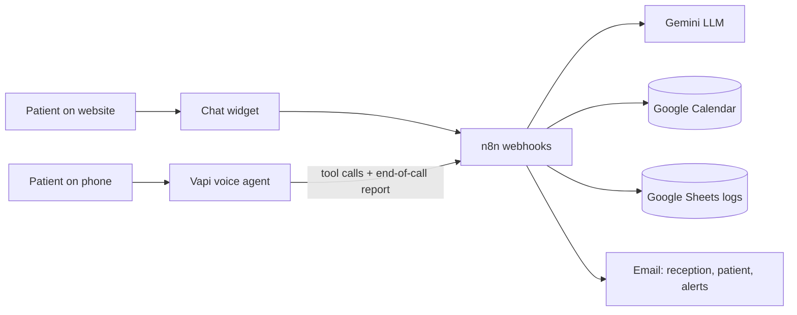

# AI Clinic Receptionist

An AI front desk for clinics that answers patients on **web chat** and on the **phone**, checks the live calendar, and books appointments, with logging and alerts so staff can trust it.

I built and deployed this for real clinics. This repo is a cleaned template: client names, contacts, calendar IDs, sheet IDs and keys have been removed.

## What it does

| Channel | How it works |
|---|---|
| Web chat | Chat widget → n8n webhook → Gemini answers questions, collects booking details, books into Google Calendar |
| Phone (IVR) | Vapi voice agent → n8n webhook → same calendar logic through two tools: `check_availability` and `book_appointment` |
| Behind both | Logs every chat, call and booking to Google Sheets, emails reception and the patient, alerts me when something breaks |

## Architecture



## The part I care about: making the agent reliable

Most of the work was not getting the agent to talk. It was stopping it from failing in front of real patients. While testing with scripted fake-patient conversations, I found and fixed failures like these:

- **Double bookings.** Vapi sometimes resends the same tool call. Every result is stored by tool-call ID and by phone + time slot, so a repeat returns the first answer instead of booking twice.
- **Slot taken mid-call.** The calendar is read again right before booking. If someone took the slot, the agent gets the remaining free times instead of an error.
- **How people actually say dates and times.** "kal", "parson", "next monday", "3 baje", "5th December". The router parses these, and a bare "3" becomes 3 PM when the clinic is closed at 3 AM.
- **Missing or bad details.** Instead of failing, the workflow tells the agent exactly what to ask again ("MISSING PHONE NUMBER. Ask for it digit by digit and repeat it back").
- **Outages.** If the calendar or sheets fail, the agent apologises and offers a transfer, and reception gets an email with the patient's details so nobody is lost.
- **Cost control.** The chat side caps message length, answers per visitor and answers per day, so a bot or abuse can't run up the LLM bill.
- **Security.** The phone webhook rejects any request without the shared secret header (401).

## Files

```
workflows/web-chat-booking-agent.json   n8n export: chat Q&A, slot lookup, booking, chat logging
phone-agent/vapi-request-router.js      core logic of the phone agent backend (validation, parsing, dedupe)
phone-agent/vapi-tools.json             tool definitions to paste into the Vapi assistant
```

The chat widget front end is in a separate repo: [Front-Desk-Receptionist](https://github.com/harishameedqazi/Front-Desk-Receptionist).

## Setup

1. Import `workflows/web-chat-booking-agent.json` into n8n.
2. Connect your own Google Calendar, Google Sheets, Gmail and Gemini credentials.
3. Fill in the **⚙️ Clinic Settings** node (branches, hours, calendar IDs, emails) and replace the clinic information in the AI system prompt.
4. For the phone agent: create a Vapi assistant, add the tools from `vapi-tools.json`, set the Server URL to your n8n webhook, and set the same secret in Vapi and in the router.

## Stack

n8n · Vapi · Google Gemini · Google Calendar · Google Sheets · Gmail · JavaScript (Luxon)
